# TP 1 — Installation de VirtualBox et création d'une VM Ubuntu

**Cours :** Introduction au Cloud — L3 SI (BDGL)
**Étudiant(e) / binôme :** TRA BI TRA Christian David / Kouadio Yao Boffouo Siedou
**Date :** 12-13 octobre 2026

**Machine hôte :** Intel Core i5-6300U (2 cœurs, 4 processeurs logiques), 16 Go de RAM, Windows 11
**Logiciels :** VirtualBox 7.2.20 (r175154), Ubuntu Server 26.04.1 LTS

> Dans ce compte rendu, les blocs de code montrent les commandes lancées et les sorties obtenues. Les captures d'écran sont dans le dossier `images/`. L'invite `PS C:\...>` indique une commande lancée dans PowerShell sur l'hôte Windows, et `etudiant@ubuntu-srv:~$` une commande lancée dans la VM.

---

## Partie 1 — Préparer l'hôte et installer VirtualBox

### 1. Virtualisation matérielle

Dans le Gestionnaire des tâches (Performance → Processeur), la ligne « Virtualisation » indique **Activé**. Le processeur a 2 cœurs et 4 processeurs logiques.

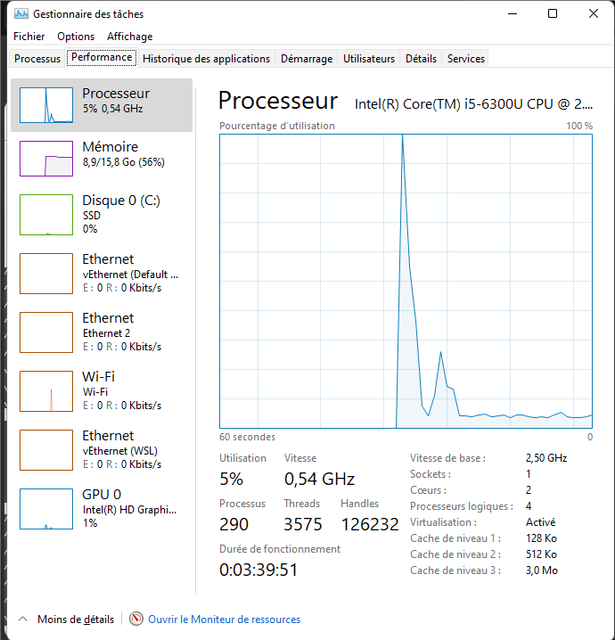

### 2. Hyperviseur de Windows

```
PS> bcdedit /enum | findstr hypervisorlaunchtype
hypervisorlaunchtype    Auto

PS> systeminfo | findstr /C:"Hyper-V"
Configuration requise pour Hyper-V: Un hyperviseur a été détecté. Les fonctionnalités
nécessaires à Hyper-V ne seront pas affichées.
```

Un hyperviseur Windows est déjà actif sur l'hôte (`hypervisorlaunchtype` vaut `Auto`). VirtualBox fonctionne quand même, avec des performances éventuellement réduites. Je n'ai pas eu besoin de désactiver cet hyperviseur.

### 3 et 4. Installation et vérification de VirtualBox

L'installateur de VirtualBox pour Windows a été lancé avec les options par défaut. Ensuite, dans PowerShell :

```
PS> $env:Path += ";C:\Program Files\Oracle\VirtualBox"
PS> VBoxManage --version
7.2.20r175154

PS> VBoxManage list hostinfo
Host Information:

Processor online count: 4
Processor count: 4
Processor online core count: 2
Processor core count: 2
Processor supports HW virtualization: yes
Processor supports PAE: yes
Processor supports long mode: yes
Processor supports nested paging: yes
Processor supports unrestricted guest: no
Processor supports nested HW virtualization: no
Processor#0 description: Intel(R) Core(TM) i5-6300U CPU @ 2.40GHz
Memory size: 16210 MByte
Memory available: 7232 MByte
Operating system: Windows 11
Operating system version: 10.0.22000.2538
```

(Sortie abrégée : les lignes `Processor#1`, `#2` et `#3` sont identiques à `#0` et ne sont pas recopiées.)

Avant l'ajout au PATH, la commande `VBoxManage --version` avait renvoyé l'erreur « le terme VBoxManage n'est pas reconnu » : le dossier de VirtualBox n'était pas encore dans le PATH de la session PowerShell. La ligne `$env:Path += ...` a résolu le problème.

### Questions

**Q1. Qu'est-ce qu'un hyperviseur de type 1 et de type 2 ? Dans quelle catégorie se range VirtualBox ? Citez un hyperviseur de type 1 utilisé par un fournisseur cloud.**

Un hyperviseur de type 1 (*bare metal*) s'exécute directement sur le matériel, sans système d'exploitation intermédiaire. Un hyperviseur de type 2 (*hosted*) est un logiciel qui s'exécute au-dessus d'un système d'exploitation existant, comme une application. **VirtualBox est de type 2**, car il tourne sur Windows. Parmi les hyperviseurs de type 1 utilisés par des fournisseurs cloud, on peut citer **KVM** (Google Cloud, et la technologie Nitro d'AWS), **Xen** (anciennes instances AWS) ou **Hyper-V** (Microsoft Azure).

**Q2. Pourquoi la virtualisation matérielle (VT-x / AMD-V) est-elle indispensable pour faire tourner une VM 64 bits ?**

VirtualBox s'appuie sur les extensions de virtualisation du processeur pour exécuter le code d'un système invité 64 bits directement et en isolation, avec de bonnes performances. Sans elles, VirtualBox ne propose que des systèmes 32 bits, ce que le tableau de dépannage du TP signale (« seul Ubuntu 32-bit est proposé »). Dans mon cas, `Processor supports HW virtualization: yes` et le Gestionnaire des tâches affiche « Virtualisation : Activé ».

**Q3. Quelle version de VirtualBox avez-vous installée ? Que renvoie `VBoxManage list hostinfo` sur le nombre de cœurs et la RAM de l'hôte ?**

Version **7.2.20** (build r175154). `hostinfo` indique **2 cœurs physiques et 4 processeurs logiques**, et **16 210 Mo de RAM** (dont 7 232 Mo disponibles au moment de la mesure).

---

## Partie 2 — Télécharger et vérifier l'image ISO Ubuntu

### Fichiers téléchargés

- `ubuntu-26.04.1-live-server-amd64.iso` : image Ubuntu Server LTS (amd64), **2 859 240 Ko, soit environ 2,73 Gio**
- `SHA256SUMS` : liste des empreintes publiée par Ubuntu pour cette version

La version utilisée est la **26.04.1**, et non la 26.04 citée dans l'énoncé. Le fichier SHA256SUMS contient les deux lignes (ligne 2 pour la 26.04, ligne 5 pour la 26.04.1), et j'ai comparé avec la ligne correspondant à mon fichier.

### Vérification de l'empreinte

```
PS> Get-FileHash .\ubuntu-26.04.1-live-server-amd64.iso -Algorithm SHA256

Algorithm       Hash
---------       ----
SHA256          CC8A95CDE20F6CED61A322420DE00F10CC3C90CED545DAA46CB9C1A117F1D927

PS> Select-String -Path .\SHA256SUMS -Pattern "live-server-amd64"

LineNumber : 2
Line       : dec49008a71f6098d0bcfc822021f4d042d5f2db279e4d75bdd981304f1ca5d9
             *ubuntu-26.04-live-server-amd64.iso

LineNumber : 5
Line       : cc8a95cde20f6ced61a322420de00f10cc3c90ced545daa46cb9c1a117f1d927
             *ubuntu-26.04.1-live-server-amd64.iso
```

L'empreinte calculée (en majuscules) et celle de la ligne 5 (en minuscules) sont **identiques**. J'avais téléchargé deux fois le fichier SHA256SUMS (un avec l'extension `.txt`). Un `Get-FileHash` sur les deux a donné la même empreinte (`4ADDE9F7...`), ils sont donc identiques.

### Questions

**Q1. Les deux empreintes sont-elles identiques ? Pourquoi faut-il vérifier l'empreinte d'une image avant de l'installer ?**

Oui, elles sont identiques, donc l'image est intègre. Il faut vérifier l'empreinte pour s'assurer que le fichier n'a pas été **corrompu** pendant le téléchargement et qu'il n'a pas été **modifié** par un tiers (une image piégée pourrait installer un système compromis).

**Q2. Quelle différence entre Ubuntu Desktop et Ubuntu Server ? Pourquoi choisit-on Server pour un serveur cloud ?**

Ubuntu Desktop inclut une interface graphique et des applications de bureau. Ubuntu Server n'a pas d'interface graphique et s'administre en ligne de commande, souvent à distance par SSH. On le choisit pour un serveur cloud parce qu'il est plus léger (moins de mémoire, de disque et de processeur), qu'il a moins de composants à maintenir et à sécuriser, et que les serveurs cloud n'ont pas d'écran.

**Q3. Que signifie LTS ? Combien d'années de mises à jour de sécurité standard une version LTS reçoit-elle ?**

LTS signifie *Long Term Support* (support à long terme). Une version LTS reçoit **5 ans** de mises à jour de sécurité standard.

---

## Partie 3 — Créer et configurer la machine virtuelle

### Création avec l'assistant

Paramètres utilisés :

| Paramètre | Valeur |
|---|---|
| Nom | `ubuntu-srv` |
| Image ISO | `ubuntu-26.04.1-live-server-amd64.iso` |
| Type / version | Linux / Ubuntu (64-bit) |
| Installation sans surveillance | désactivée (« Ignorer l'installation sans surveillance ») |
| Mémoire vive | 2048 Mo |
| Processeurs | 2 |
| Disque dur | VDI, 25 Go, alloué dynamiquement |
| Carte réseau 1 | NAT |

À la première tentative, l'assistant m'a amené sur la page « Set up unattended guest OS installation » (nom d'utilisateur `vboxuser`, mot de passe, etc.). Je suis revenu en arrière et j'ai coché « Ignorer l'installation sans surveillance », conformément à l'énoncé.

Résumé de la VM créée (mémoire 2048 Mo, 2 processeurs, disque `ubuntu-srv.vdi` 25 Go, ISO montée, interface en NAT) :

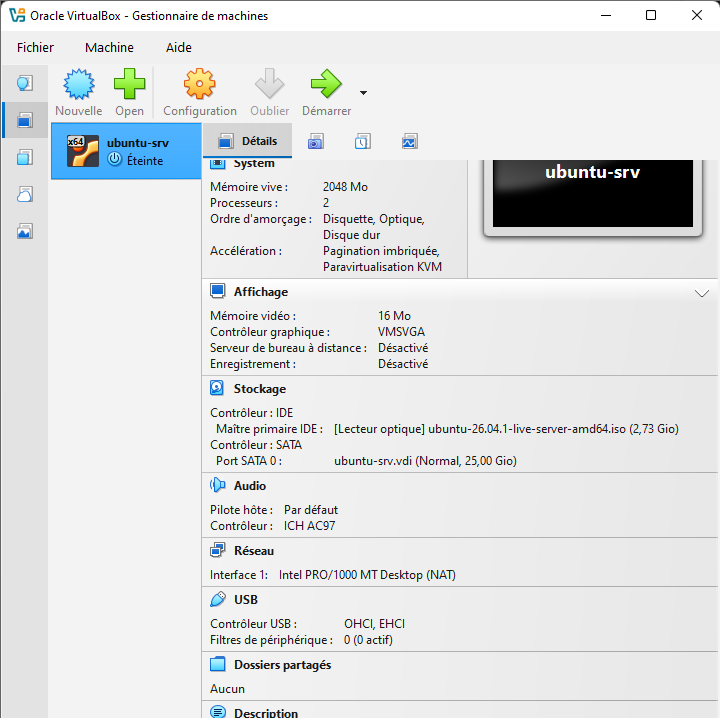

### Réseau NAT et redirection de port

La carte 1 est en mode **NAT** (ligne « Réseau » du résumé ci-dessus).

J'ai d'abord créé la règle de redirection via l'interface, qui l'a nommée `Rule 1` :

```
PS> VBoxManage showvminfo ubuntu-srv | Select-String "Rule"
NIC 1 Rule(0):   name = Rule 1, protocol = tcp, host ip = 127.0.0.1, host port = 2222, guest ip = , guest port = 22
```

Comme la suite du TP (partie 6) utilise une règle nommée `ssh`, je l'ai supprimée puis recréée avec le bon nom :

```
PS> VBoxManage modifyvm ubuntu-srv --natpf1 delete "Rule 1"
PS> VBoxManage modifyvm ubuntu-srv --natpf1 "ssh,tcp,127.0.0.1,2222,,22"
PS> VBoxManage showvminfo ubuntu-srv | Select-String "Rule"
NIC 1 Rule(0):   name = ssh, protocol = tcp, host ip = 127.0.0.1, host port = 2222, guest ip = , guest port = 22
```

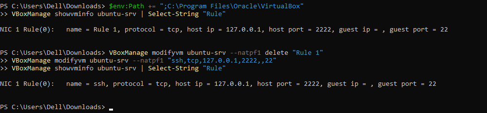

### Questions

**Q1. Quelle différence entre un disque alloué dynamiquement et un disque de taille fixe ? Quelle place occupe le fichier .vdi juste après sa création ?**

Un disque **alloué dynamiquement** grandit au fur et à mesure que la VM écrit des données, jusqu'à la taille maximale de 25 Go. Un disque de **taille fixe** réserve immédiatement les 25 Go sur le disque de l'hôte. Il peut être un peu plus rapide, mais il occupe toute la place dès le départ. Juste après la création, le fichier `.vdi` d'un disque dynamique est **très petit**, bien inférieur à 25 Go (je n'ai pas mesuré la valeur exacte lors de la création).

**Q2. Pourquoi désactive-t-on l'installation sans surveillance pour ce TP ?**

L'installation sans surveillance remplit automatiquement l'installateur (utilisateur `vboxuser`, mot de passe, nom de domaine...). On la désactive pour **passer soi-même par chaque écran de l'installateur** (clavier, réseau, stockage, profil, SSH) et comprendre les choix, au lieu de laisser VirtualBox tout décider.

**Q3. En mode NAT, pourquoi l'hôte ne peut-il pas joindre directement la VM ? À quoi sert la redirection 2222 → 22 ?**

En NAT, la VM est derrière un routeur virtuel de VirtualBox, avec une adresse privée (`10.0.2.15`) qui n'est pas accessible depuis l'hôte : la VM peut sortir vers Internet, mais personne ne peut ouvrir de connexion vers elle de l'extérieur. La **redirection de port** fait suivre au VirtualBox NAT tout ce qui arrive sur `127.0.0.1:2222` de l'hôte vers le port **22 (SSH)** de la VM, ce qui permet de s'y connecter en SSH.

---

## Partie 4 — Installer Ubuntu Server

### Déroulement

L'installation a été lancée avec « Try or Install Ubuntu Server ». Choix effectués :

| Écran | Choix |
|---|---|
| Langue | Français |
| Mise à jour de l'installateur | Continuer sans mettre à jour |
| Clavier | French (AZERTY) |
| Type d'installation | Ubuntu Server (pas la version minimisée) |
| Réseau | `enp0s3` en DHCPv4, adresse obtenue **10.0.2.15/24** |
| Proxy / miroir | par défaut (`http://ci.archive.ubuntu.com/ubuntu/`) |
| Stockage | tout le disque, avec LVM (par défaut) |
| Profil | serveur `ubuntu-srv`, utilisateur `etudiant`, mot de passe choisi |
| Ubuntu Pro | passer (« Skip for now ») |
| SSH | installer le serveur OpenSSH |
| Snaps | aucun |

Écran réseau : j'ai ouvert par erreur la fenêtre « Create bond » (agrégation de plusieurs cartes réseau), que j'ai annulée car la VM n'a qu'une seule carte. L'adresse DHCPv4 obtenue sur `enp0s3` est `10.0.2.15/24`.

Écran miroir : le test du miroir a réussi, ce qui montre que la VM a accès à Internet.

Écran stockage : le volume logique `/` fait 11,5 Go (le groupe de volumes LVM `ubuntu-vg` reste en partie libre, c'est le comportement par défaut d'Ubuntu), et `/boot` fait 2 Go :

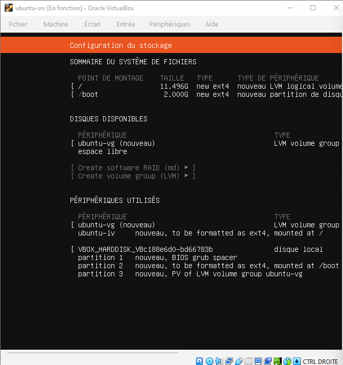

Après le redémarrage, première connexion sur la console avec `etudiant` (adresse IPv4 10.0.2.15 visible) :

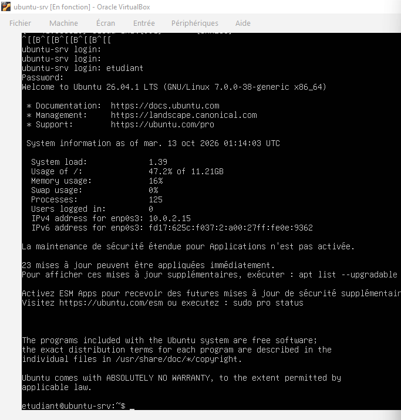

### Durée de l'installation

**Environ 35 à 40 minutes**, du premier écran de l'installateur (vers 02:35 sur l'horloge de l'hôte) au premier démarrage du système installé (vers 03:13). Cette valeur est **estimée à partir de l'heure des captures d'écran**, je n'ai pas chronométré. Elle comprend le temps passé à répondre aux écrans de l'installateur (environ 15 minutes) et l'installation automatique.

### Questions

**Q1. Combien de temps a duré l'installation ? Comparez avec la création d'une instance cloud à partir d'une image prête.**

Environ 35 à 40 minutes (estimation, voir ci-dessus). Une instance cloud (EC2, Azure VM) est créée à partir d'une **image déjà prête** : elle démarre en général en une à deux minutes, sans passer par l'installateur. C'est l'un des gains du cloud IaaS : on ne réinstalle pas le système à chaque fois.

**Q2. Quelle adresse IP l'installateur a-t-il obtenue sur `enp0s3` ? Qui l'a attribuée ?**

L'adresse **10.0.2.15/24**. Elle a été attribuée par le **serveur DHCP intégré à VirtualBox**, qui fait partie du réseau NAT virtuel.

**Q3. Pourquoi installe-t-on le serveur OpenSSH dès l'installation ? Que se passerait-il sur un serveur cloud sans SSH ?**

Parce que SSH est le moyen standard d'**administrer un serveur à distance** : sans lui, on ne peut pas s'y connecter depuis l'hôte. Sur un serveur cloud sans SSH (ni autre moyen d'accès), on ne pourrait pas administrer la machine à distance, car il n'y a pas d'écran ni de clavier physique : elle deviendrait inutilisable.

---

## Partie 5 — Premiers pas, réseau et accès SSH

### 1. Identifier le système et ses ressources

```
etudiant@ubuntu-srv:~$ lsb_release -a
No LSB modules are available.
Distributor ID: Ubuntu
Description:    Ubuntu 26.04.1 LTS
Release:        26.04
Codename:       resolute
```

```
etudiant@ubuntu-srv:~$ hostnamectl
 Static hostname: ubuntu-srv
       Icon name: computer-vm
         Chassis: vm
  Virtualization: oracle
Operating System: Ubuntu 26.04.1 LTS
          Kernel: Linux 7.0.0-38-generic
    Architecture: x86-64
 Hardware Vendor: innotek GmbH
  Hardware Model: VirtualBox
```

(Sortie abrégée : la capture ci-dessous montre aussi les identifiants de machine et la version du microprogramme.)

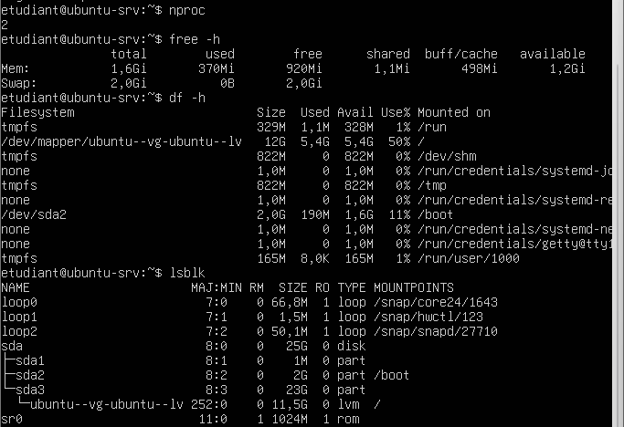

Le noyau est donc `7.0.0-38-generic`, ce qu'affiche aussi la ligne de bienvenue Ubuntu.

```
etudiant@ubuntu-srv:~$ nproc
2

etudiant@ubuntu-srv:~$ free -h
               total        used        free      shared  buff/cache   available
Mem:           1,6Gi       370Mi       920Mi       1,1Mi       498Mi       1,2Gi
Swap:          2,0Gi          0B       2,0Gi

etudiant@ubuntu-srv:~$ df -h /
Filesystem                         Size  Used Avail Use% Mounted on
/dev/mapper/ubuntu--vg-ubuntu--lv   12G  5,4G  5,4G  50% /
```

`lsblk` montre le disque `sda` de 25 Go, avec `sda1` (1 Mo, réservé), `sda2` (2 Go, `/boot`) et `sda3` (23 Go, volume physique LVM), sur lequel repose le volume logique `ubuntu--vg-ubuntu--lv` de 11,5 Go monté sur `/`. Les trois périphériques `loop` sont des paquets snap. Les erreurs de frappe visibles sur la capture (`hostnamect1`, `hosnamectl`) ont été corrigées ensuite.

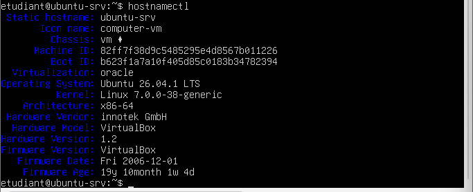

### 2. Réseau et accès à Internet

```
etudiant@ubuntu-srv:~$ ip -4 addr show
2: enp0s3: ...
    inet 10.0.2.15/24 metric 100 brd 10.0.2.255 scope global dynamic enp0s3

etudiant@ubuntu-srv:~$ ip route
default via 10.0.2.2 dev enp0s3 proto dhcp src 10.0.2.15 metric 100
10.0.2.0/24 dev enp0s3 proto kernel scope link src 10.0.2.15 metric 100
10.0.2.2 dev enp0s3 proto dhcp scope link src 10.0.2.15 metric 100
192.168.1.1 via 10.0.2.2 dev enp0s3 proto dhcp src 10.0.2.15 metric 100

etudiant@ubuntu-srv:~$ resolvectl status | grep "DNS Servers"
       DNS Servers: 192.168.1.1 fd17:625c:f037::3

etudiant@ubuntu-srv:~$ ping -c 3 ubuntu.com
PING ubuntu.com (91.189.91.45) 56(84) bytes of data.
64 bytes from fautso.canonical.com (91.189.91.45): icmp_seq=1 ttl=64 time=187 ms
64 bytes from fautso.canonical.com (91.189.91.45): icmp_seq=2 ttl=64 time=203 ms
64 bytes from fautso.canonical.com (91.189.91.45): icmp_seq=3 ttl=64 time=188 ms

--- ubuntu.com ping statistics ---
3 packets transmitted, 3 received, 0% packet loss, time 2002ms
rtt min/avg/max/mdev = 187.494/193.009/203.071/7.125 ms
```

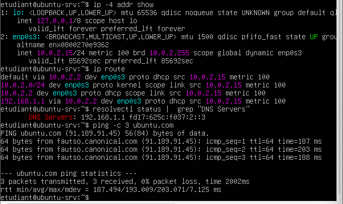

`sudo apt update && sudo apt upgrade -y` a été lancé : les 23 mises à jour disponibles ont été appliquées (à l'ouverture de session suivante, le système indique « 0 mise à jour peut être appliquée immédiatement »).

### 3. Vérification du serveur SSH

```
etudiant@ubuntu-srv:~$ systemctl status ssh --no-pager
● ssh.service - OpenBSD Secure Shell server
     Active: active (running) since Tue 2026-10-13 01:13:05 UTC
   Main PID: 1074 (sshd)
oct. 13 01:13:05 ubuntu-srv sshd[1074]: Server listening on 0.0.0.0 port 22.
oct. 13 01:13:05 ubuntu-srv sshd[1074]: Server listening on :: port 22.

etudiant@ubuntu-srv:~$ sudo ss -tlnp | grep :22
LISTEN 0   4096   0.0.0.0:22   0.0.0.0:*   users:(("sshd",pid=1074,fd=3),...)
LISTEN 0   4096      [::]:22      [::]:*   users:(("sshd",pid=1074,fd=4),...)
```

(Sortie abrégée.)

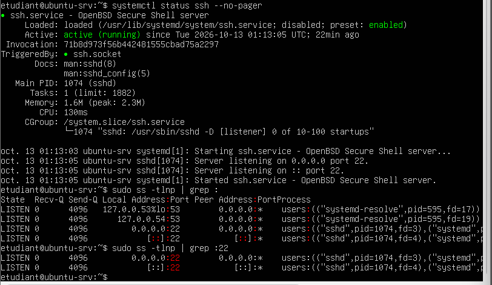

### 4. Connexion depuis l'hôte et copie de fichier

**Incident : mot de passe refusé.** Mes premières connexions SSH depuis PowerShell ont été refusées :

```
PS> ssh -p 2222 etudiant@127.0.0.1
etudiant@127.0.0.1's password:
Permission denied, please try again.
...
etudiant@127.0.0.1: Permission denied (publickey,password).
```

Le serveur SSH répondait donc bien (la redirection de port fonctionnait), mais refusait le mot de passe. Le journal du serveur le confirme (`journalctl -u ssh`) : plusieurs lignes `Failed password for etudiant from 10.0.2.2`, puis `Connection reset by authenticating user etudiant` après trois échecs. On voit au passage que les connexions arrivent de **10.0.2.2**, l'adresse de la passerelle NAT.

**Cause probable :** le mot de passe avait été saisi pendant l'installation avec une disposition de clavier différente de celle de Windows. **Solution :** redéfinir le mot de passe depuis la console de la VM, avec un mot de passe simple en minuscules :

```
etudiant@ubuntu-srv:~$ sudo passwd etudiant
New password:
Retype new password:
passwd : mot de passe mis à jour avec succès
```

**Connexion réussie :**

```
PS> ssh -p 2222 etudiant@127.0.0.1
etudiant@127.0.0.1's password:
Welcome to Ubuntu 26.04.1 LTS (GNU/Linux 7.0.0-38-generic x86_64)
...
etudiant@ubuntu-srv:~$
```

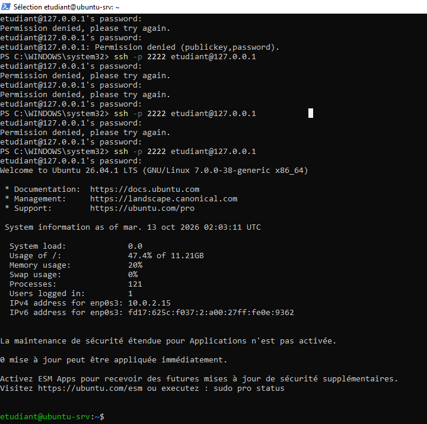

**Copie d'un fichier avec `scp` :**

```
PS> "Bonjour depuis l'hôte" | Out-File -Encoding utf8 bonjour.txt
PS> scp -P 2222 .\bonjour.txt etudiant@127.0.0.1:~
bonjour.txt                          100%   27     6.5KB/s   00:00
PS> ssh -p 2222 etudiant@127.0.0.1 "cat ~/bonjour.txt"
B onjour depuis l'hôte
```

Le fichier fait 27 octets : `Out-File -Encoding utf8` de Windows PowerShell ajoute une marque d'ordre des octets (BOM), qui apparaît comme un caractère étrange au début de la ligne.

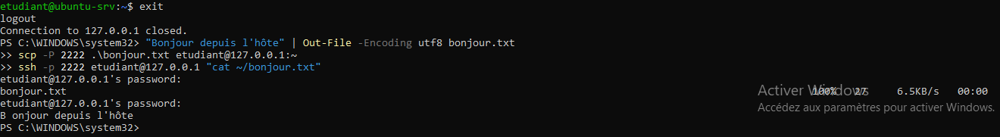

### 5. Bonus — connexion par clé

```
PS> ssh-keygen -t ed25519
(emplacement par défaut, phrase secrète vide)
Your identification has been saved in C:\Users\Dell/.ssh/id_ed25519.
Your public key has been saved in C:\Users\Dell/.ssh/id_ed25519.pub.

PS> type $env:USERPROFILE\.ssh\id_ed25519.pub | ssh -p 2222 etudiant@127.0.0.1 "mkdir -p ~/.ssh && cat >> ~/.ssh/authorized_keys"
etudiant@127.0.0.1's password:

PS> ssh -p 2222 etudiant@127.0.0.1 "echo connexion par cle OK"
connexion par cle OK
```

La dernière commande a répondu **sans demander de mot de passe**.

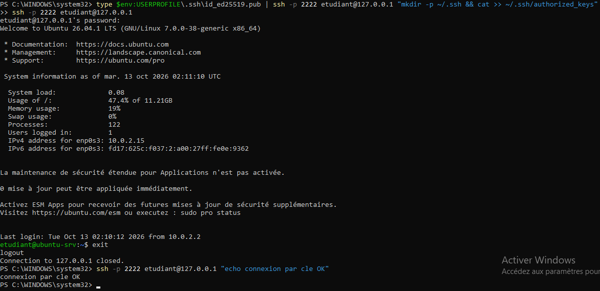

### Questions

**Q1. Relevez l'adresse IP, le masque, la passerelle et le serveur DNS de la VM. À quoi correspond la passerelle 10.0.2.2 ?**

- Adresse IP : **10.0.2.15**
- Masque : **/24** (255.255.255.0)
- Passerelle : **10.0.2.2**
- Serveur DNS : **192.168.1.1** (le DNS de l'hôte, transmis par VirtualBox)

La passerelle 10.0.2.2 est l'**adresse du routeur virtuel NAT de VirtualBox** : tout le trafic de la VM vers l'extérieur passe par lui, et c'est aussi lui qui représente l'hôte vis-à-vis de la VM.

**Q2. Pourquoi se connecte-t-on à 127.0.0.1:2222 et non directement à 10.0.2.15:22 ?**

Parce que `10.0.2.15` est une adresse privée à l'intérieur du réseau NAT de VirtualBox : l'hôte ne peut pas l'atteindre directement. Il faut passer par la **redirection de port** : le port 2222 de l'hôte (127.0.0.1) est relié au port 22 de la VM.

**Q3. Que contient le message affiché à la première connexion SSH (empreinte) ? Quel risque permet-il d'éviter ?**

Il affiche l'**empreinte de la clé publique du serveur** et demande de confirmer qu'on veut continuer à s'y connecter. Si l'empreinte est acceptée, elle est enregistrée dans `known_hosts` et comparée à chaque connexion suivante. Cela permet d'éviter une **attaque de l'homme du milieu** : quelqu'un qui se ferait passer pour le serveur serait détecté si son empreinte était différente.

**Q4. Quels avantages offre l'authentification par clé par rapport au mot de passe ? Pourquoi les fournisseurs cloud l'imposent-ils par défaut ?**

Avec une clé, la clé privée **ne circule jamais sur le réseau** (seule une preuve cryptographique est échangée), elle ne peut pas être **devinée par force brute** comme un mot de passe faible, et elle permet de se connecter sans saisir de mot de passe, ce qui facilite l'automatisation. Les fournisseurs cloud l'imposent par défaut parce que leurs serveurs sont **exposés sur Internet** et reçoivent en permanence des tentatives de connexion par mot de passe.

---

## Partie 6 — Instantané, clone et arrêt

### 1. Instantané de la VM propre

```
PS> VBoxManage snapshot ubuntu-srv take apres-installation --description "Ubuntu installé, OpenSSH actif"
0%...10%...20%...30%...40%...50%...60%...70%...80%...90%...100%
Snapshot taken. UUID: b03d90ec-fa43-4ac9-9d18-d32fde3ebc06

PS> VBoxManage snapshot ubuntu-srv list
   Name: apres-installation (UUID: b03d90ec-fa43-4ac9-9d18-d32fde3ebc06) *
   Description: Ubuntu installé, OpenSSH actif
```

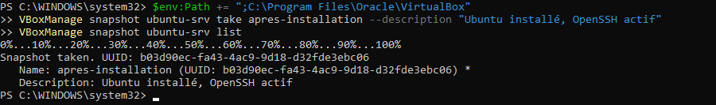

### 2 et 3. Modification, arrêt et restauration

**Premier essai (limite).** Mes premières commandes (`sudo apt install -y htop`, `touch`, `sudo poweroff`) ont été tapées par erreur dans **PowerShell sur Windows** et non dans la VM : `sudo` n'existe pas sous Windows, donc la VM n'a pas été éteinte. Dans la VM, le fichier `avant-restauration.txt` a ensuite été créé et la VM éteinte correctement. Après la restauration, `avant-restauration.txt` a bien disparu, mais **`htop` est resté**, probablement parce qu'il était déjà installé avant l'instantané (le `apt install` du premier essai n'avait jamais été exécuté dans la VM). Ce premier essai ne montre donc que la disparition du fichier. Je l'ai refait avec un paquet absent de l'instantané (ci-dessous).

**Second essai, avec un paquet absent de l'instantané : `tree`.** Dans la VM :

```
etudiant@ubuntu-srv:~$ sudo apt install -y tree
...
etudiant@ubuntu-srv:~$ touch ~/avant-restauration.txt
etudiant@ubuntu-srv:~$ ls ~
avant-restauration.txt  bonjour.txt
etudiant@ubuntu-srv:~$ which tree
/usr/bin/tree
etudiant@ubuntu-srv:~$ sudo poweroff
```

Restauration et vérification, depuis l'hôte :

```
PS> VBoxManage list runningvms
(aucune ligne : la VM est éteinte)
PS> VBoxManage snapshot ubuntu-srv restore apres-installation
Restoring snapshot 'apres-installation' (b03d90ec-fa43-4ac9-9d18-d32fde3ebc06)
0%...10%...20%...30%...40%...50%...60%...70%...80%...90%...100%
PS> VBoxManage startvm ubuntu-srv --type headless
VM "ubuntu-srv" has been successfully started.
PS> ssh -p 2222 etudiant@127.0.0.1 "which tree; ls ~"
bonjour.txt
```

Après la restauration, **`tree` et `avant-restauration.txt` ont disparu** : la VM est revenue à l'état de l'instantané.

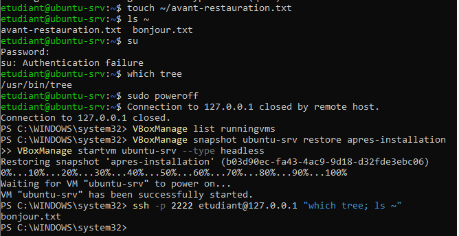

### 4. Clone sur le port 2223

```
PS> VBoxManage controlvm ubuntu-srv acpipowerbutton
PS> VBoxManage list runningvms
PS> VBoxManage clonevm ubuntu-srv --name ubuntu-clone --register
0%...10%...20%...30%...40%...50%...60%...70%...80%...90%...100%
Machine has been successfully cloned as "ubuntu-clone"
PS> VBoxManage modifyvm ubuntu-clone --natpf1 delete ssh
PS> VBoxManage modifyvm ubuntu-clone --natpf1 "ssh,tcp,127.0.0.1,2223,,22"
PS> VBoxManage startvm ubuntu-clone --type headless
VM "ubuntu-clone" has been successfully started.
PS> ssh -t -p 2223 etudiant@127.0.0.1 "sudo hostnamectl set-hostname ubuntu-clone; hostname"
The authenticity of host '[127.0.0.1]:2223 ...' can't be established.
...Are you sure you want to continue connecting (yes/no/[fingerprint])? yes
[sudo: authenticate] Password:
ubuntu-clone
Connection to 127.0.0.1 closed.
PS> VBoxManage list runningvms
"ubuntu-clone" {90b23d54-5e87-4952-8a6d-442db59a8249}
```

L'option `-t` du `ssh` a été nécessaire pour que `sudo` puisse demander le mot de passe. Pour l'hôte, `[127.0.0.1]:2223` est un serveur inconnu : SSH a donc redemandé de confirmer l'empreinte.

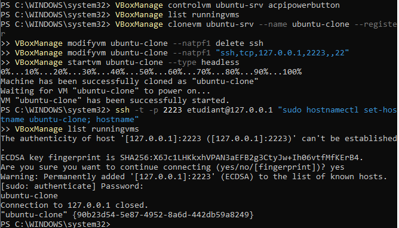

### 5. Comparaison de la place occupée et suppression du clone

```
ubuntu-clone : 6,24 Go
ubuntu-srv : 7,17 Go
```

Le clone est un **clone complet** : son disque est une copie de celui de l'original, il occupe donc presque autant de place. L'original est probablement plus gros parce qu'il contient aussi l'instantané et l'état sauvegardé.

**Incident :** la première suppression a échoué (`Cannot unregister the machine 'ubuntu-clone' while it is locked`), car j'avais lancé `unregistervm` immédiatement après `acpipowerbutton`, sans laisser le temps à la VM de s'éteindre.

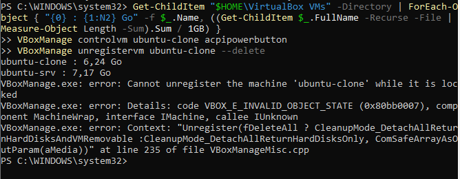

Après avoir attendu et vérifié que `list runningvms` était vide :

```
PS> VBoxManage unregistervm ubuntu-clone --delete
0%...10%...20%...30%...40%...50%...60%...70%...80%...90%...100%
PS> VBoxManage list vms
"ubuntu-srv" {1a1fc102-b4b6-49da-8871-fb0dfeafdeea}
```

Il ne reste que `ubuntu-srv`, conservée pour les TP suivants.

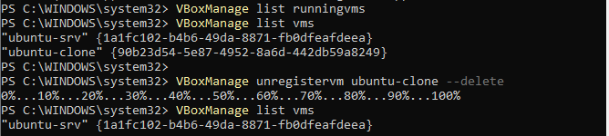

### Questions

**Q1. Quelle différence entre un instantané et un clone ? Un instantané est-il une sauvegarde ? Justifiez.**

Un **instantané** est un point de retour **dans la même VM** : il enregistre l'état à un instant donné et les modifications suivantes sont écrites séparément. Un **clone** est une **nouvelle VM indépendante**, copie de l'original. Un instantané **n'est pas une vraie sauvegarde** : il dépend du disque d'origine, donc si ce disque est perdu ou corrompu, l'instantané l'est aussi, et il reste stocké au même endroit que la VM.

**Q2. Quels sont les équivalents cloud de l'instantané et du clone ?**

L'instantané correspond aux **snapshots de disque** (par exemple les snapshots EBS d'AWS ou les snapshots de disque Azure). Le clone correspond à une **image** (AMI chez AWS, image personnalisée chez Azure) à partir de laquelle on lance autant de nouvelles instances qu'on veut.

**Q3. Quelle différence entre `acpipowerbutton` et `poweroff` dans `VBoxManage controlvm` ?**

`acpipowerbutton` simule un **appui sur le bouton d'alimentation** : le système invité reçoit le signal et s'éteint **proprement** (arrêt des services, écriture des données). `poweroff` **coupe la VM brutalement**, comme si on débranchait la prise, ce qui peut corrompre des données.

**Q4. Pourquoi démarrer une VM en mode headless ? Quel lien avec une instance cloud ?**

Le mode *headless* démarre la VM **sans fenêtre graphique** : on l'administre uniquement à distance, par SSH. C'est exactement le cas d'une instance cloud, qui n'a ni écran ni clavier et dont on ne voit que le réseau.

**Q5. Pourquoi faut-il changer le port hôte et le nom d'hôte du clone ?**

Le **port hôte** doit être différent (2223 au lieu de 2222) parce que deux règles de redirection ne peuvent pas utiliser le même port de l'hôte : le clone aurait la même règle que l'original (clonée avec la VM) et entrerait en conflit si les deux tournent en même temps. Le **nom d'hôte** doit changer parce que le clone a le même nom que l'original : deux machines ayant la même identité sur un réseau sont difficiles à distinguer et peuvent poser des problèmes.

---

## Conclusion

Ce TP m'a permis d'installer un hyperviseur de type 2 (VirtualBox), de créer et configurer une VM, d'installer Ubuntu Server, de m'y connecter par SSH (avec mot de passe puis avec clé) depuis la machine hôte, et de manipuler instantanés et clones. J'ai rencontré et résolu quelques incidents : mot de passe refusé en SSH, commandes lancées sur le mauvais système, règle de redirection mal nommée, suppression de clone lancée trop tôt. Ils m'ont aidé à comprendre ce que le cloud IaaS automatise : création d'instance à partir d'une image, accès SSH par clé, réseau privé avec redirection de port, snapshots et images.
